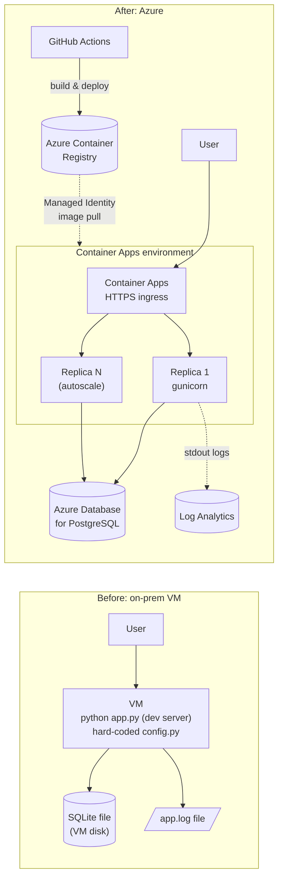

# 🚀 Modernize an On-Prem Python App to Azure Container Apps (Hands-on Lab)

🌐 **English** | [한국어](README.md)

In this lab you take a Flask app that used to run on an on-premises VM with `python app.py` and **containerize** it, deploy it to **Azure Container Apps**, and then add a **managed database (PostgreSQL)**, **autoscaling**, **zero-downtime releases** and **CI/CD**.

> ⏱️ Duration: ~2.5–3 hours (including the optional lab) · 💰 Cost: a few dollars at most; delete the resource group at the end

---

## What you will learn

| # | Topic | Key Azure services |
|---|-------|--------------------|
| 1 | Why a legacy app is hard to run in the cloud | - |
| 2 | Make the app cloud-native (env vars, stdout logs) + write a Dockerfile | Docker |
| 3 | Build the image & private registry | Azure Container Registry |
| 4 | Serverless container deployment | Azure Container Apps |
| 5 | Move local SQLite data to a managed DB, handle secrets | Azure Database for PostgreSQL |
| 6 | Logs, autoscaling, blue/green (traffic splitting) | Log Analytics, Revisions |
| 7 | (Optional) Push-to-deploy pipeline | GitHub Actions + OIDC |

## Architecture: Before → After



### On-prem → Azure concept mapping

| On the on-prem VM… | On Container Apps… |
|---|---|
| Edit `config.py` by hand on every server | Inject **environment variables / secrets** (same code, different values) |
| `python app.py` dev server | Container image running **gunicorn** |
| SSH in and `tail -f` a log file | **stdout** → collected automatically into Log Analytics |
| SQLite on the VM disk | **Managed PostgreSQL** (backups/HA included) |
| One VM = fixed capacity, manual scaling | **Automatic replica scaling** (0 … N) |
| Manual deploy (scp, systemctl restart) | **Revisions** + traffic splitting, CI/CD |

## Sample app: Contoso Inventory

A small internal inventory web app built with Flask + SQLAlchemy. The footer shows **hostname / version / DB backend**, so you can *see* the effect of scale-out, revisions and the database switch.

> 🇰🇷 **Note:** The app UI labels, sample data and code comments are in Korean. UI cheat sheet: 재고 등록 = *Register item*, 품목명 = *Item name*, 수량 = *Quantity*, 보관 위치 = *Location*, 추가 = *Add*, 삭제 = *Delete*, 재고 목록 = *Inventory list*, 실행 환경 정보 = *Runtime info*.

## Repository layout

```
.
├── app/                    # ⭐ Lab starting point = the "on-prem VM" legacy app (you edit this)
│   ├── app.py  config.py  requirements.txt  templates/
│   └── deploy-onprem/      #   How the VM was operated (systemd unit, reference only)
├── solution/               # ✅ Reference solution (compare / copy when stuck). Includes Dockerfile + GitHub Actions template
├── tools/
│   ├── migrate_sqlite_to_postgres.py   # data migration script
│   └── loadtest.py                     # zero-install load generator
├── scripts/env.sh          # variables used across the lab (source it)
├── docs/                   # 📚 Lab guides in Korean (docs/en/ = English)
└── .devcontainer/          # GitHub Codespaces / Dev Container config
```

## Labs

| Lab | Title | Time |
|---|---|---|
| [Lab 0](docs/en/lab0-setup.md) | Environment setup (Codespaces, Azure login) | 15 min |
| [Lab 1](docs/en/lab1-legacy-app.md) | Run the legacy app and find its problems | 15 min |
| [Lab 2](docs/en/lab2-containerize.md) | Code changes + write a Dockerfile (containerize) | 30 min |
| [Lab 3](docs/en/lab3-azure-resources.md) | Create Azure resources & build the image (ACR) | 20 min |
| [Lab 4](docs/en/lab4-deploy.md) | Deploy to Container Apps & experience the "state problem" | 25 min |
| [Lab 5](docs/en/lab5-database.md) | Modernize data with PostgreSQL | 30 min |
| [Lab 6](docs/en/lab6-operate.md) | Logs · autoscaling · blue/green deployment | 30 min |
| [Lab 7](docs/en/lab7-cicd.md) | (Optional) CI/CD with GitHub Actions | 20 min |
| [Lab 8](docs/en/lab8-cleanup.md) | Clean up | 5 min |

Stuck? → [Troubleshooting](docs/en/troubleshooting.md)

## Prerequisites

- An **Azure subscription** (Contributor or higher, able to create resource groups)
- A **GitHub account** (Codespaces recommended — nothing to install)
- (If working locally) Python 3.10+, Azure CLI 2.60+, Docker (optional), Git

## 💰 Estimated cost

Paid resources created in the labs and their approximate cost (Korea Central, pay-as-you-go; **rough estimates for reference only** — prices vary over time. Check the [Azure pricing calculator](https://azure.microsoft.com/pricing/calculator/) for exact figures).

| Resource | SKU / settings | Approximate cost |
|---|---|---|
| Azure Container Registry | Basic | ~$0.17/day (~$5/month) |
| PostgreSQL Flexible Server | Burstable B1ms + 32 GiB | ~$0.5–0.7/day (~$15–20/month) |
| Container Apps | Consumption, 0.5 vCPU / 1 GiB, up to 5 replicas | Mostly within the monthly free grant (180,000 vCPU-s, 360,000 GiB-s, 2M requests) |
| Log Analytics | Pay-as-you-go | Lab-scale log volume is practically free |
| Managed Identity | User-assigned | Free |

- **A one-day workshop (3–4 hours) typically costs under $1 in total.**
- If you skip Lab 8 and leave everything running, expect roughly **$20–25/month**.
- ✅ When you finish, delete the resource group with [Lab 8 — Cleanup](docs/en/lab8-cleanup.md).
- Free-account credits or Visual Studio/MSDN subscription credits are enough to complete the labs.

## Getting started

1. **Fork** this repository (needed for the Lab 7 CI/CD exercise).
2. In your fork: **Code → Codespaces → Create codespace on main**.
3. Start with [Lab 0](docs/en/lab0-setup.md).

> 💡 **Facilitator tip:** Every lab ends with a ✅ **checkpoint**. If someone can't pass it, have them compare with `solution/`. Creating PostgreSQL (Lab 5) takes 5–10 minutes, so start it before Lab 4 to save time.

## 📄 License

[MIT License](LICENSE) — free to use, modify, and redistribute. The sample app (Contoso Inventory) is a fictional example, and Azure charges are billed to your own subscription.
