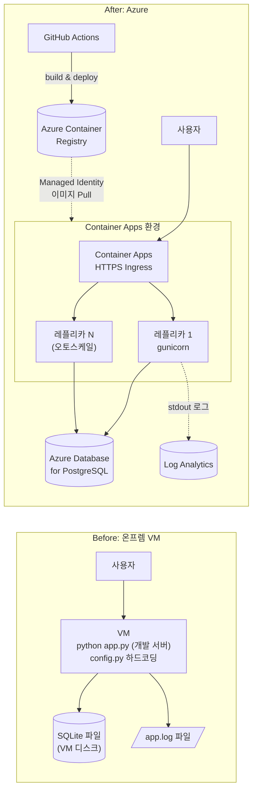

# 🚀 온프렘 Python 앱을 Azure Container Apps로 현대화하기 (Hands-on Lab)

온프렘 VM에서 `python app.py` 로 돌던 Flask 앱을 **컨테이너화**하고, **Azure Container Apps**에 배포하고, **관리형 DB(PostgreSQL)**·**오토스케일**·**무중단 배포**·**CI/CD**까지 적용해 보는 실습입니다.

> ⏱️ 소요 시간: 약 2.5 ~ 3시간 (선택 실습 포함) · 💰 예상 비용: 실습 중 몇 달러 이내, 마지막에 리소스 그룹 삭제 · 🌐 언어: 한국어

---

## 이 실습에서 배우는 것

| # | 배우는 것 | 핵심 Azure 서비스 |
|---|-----------|------------------|
| 1 | 레거시 앱이 클라우드에 올리기 어려운 이유 이해 | - |
| 2 | 앱을 클라우드 네이티브하게 고치기 (환경변수, stdout 로그) + Dockerfile | Docker |
| 3 | 이미지 빌드 & 프라이빗 레지스트리 | Azure Container Registry |
| 4 | 서버리스 컨테이너 배포 | Azure Container Apps |
| 5 | 로컬 SQLite → 관리형 DB 로 데이터 이전, 비밀 값 관리 | Azure Database for PostgreSQL |
| 6 | 로그 조회, 오토스케일, 블루/그린(트래픽 분할) | Log Analytics, Revisions |
| 7 | (선택) 푸시하면 자동 배포되는 파이프라인 | GitHub Actions + OIDC |

## 아키텍처: Before → After



### 온프렘 → Azure 개념 매핑

| 온프렘 VM에서는… | Container Apps에서는… |
|---|---|
| `config.py` 를 서버마다 직접 수정 | **환경 변수 / Secret** 으로 주입 (코드 동일, 값만 다름) |
| `python app.py` 개발 서버 | **gunicorn** 으로 실행하는 컨테이너 이미지 |
| 로그 파일을 SSH 로 접속해서 `tail -f` | **stdout** → Log Analytics 자동 수집 |
| VM 디스크의 SQLite | **PostgreSQL 관리형 DB** (백업/HA 제공) |
| VM 1대 = 용량 한계, 수동 증설 | **레플리카 자동 확장** (0 ~ N) |
| 수동 배포 (scp, systemctl restart) | **리비전** + 트래픽 분할, CI/CD |

## 샘플 앱: Contoso Inventory

사내 재고 관리용 Flask + SQLAlchemy 웹 앱입니다. 화면 하단에 **hostname / version / DB 종류**가 표시되어서, 스케일 아웃·리비전·DB 전환 효과를 눈으로 확인할 수 있습니다.

## 폴더 구조

```
.
├── app/                    # ⭐ 실습 시작점 = "온프렘 VM 버전" 레거시 앱 (여기를 수정합니다)
│   ├── app.py  config.py  requirements.txt  templates/
│   └── deploy-onprem/      #   예전 VM 운영 방식 (systemd 파일, 참고용)
├── solution/               # ✅ 정답 (막히면 비교/복사). Dockerfile, GitHub Actions 템플릿 포함
├── tools/
│   ├── migrate_sqlite_to_postgres.py   # 데이터 이전 스크립트
│   └── loadtest.py                     # 설치 없이 쓰는 부하 생성기
├── scripts/env.sh          # 실습 전체에서 쓰는 변수 정의 (source 해서 사용)
├── docs/                   # 📚 실습 가이드 (순서대로 진행)
└── .devcontainer/          # GitHub Codespaces / Dev Container 설정
```

## 실습 순서

| 실습 | 제목 | 시간 |
|---|---|---|
| [Lab 0](docs/lab0-setup.md) | 환경 준비 (Codespaces, Azure 로그인) | 15분 |
| [Lab 1](docs/lab1-legacy-app.md) | 레거시 앱 실행하고 문제점 찾기 | 15분 |
| [Lab 2](docs/lab2-containerize.md) | 코드 수정 + Dockerfile 작성 (컨테이너화) | 30분 |
| [Lab 3](docs/lab3-azure-resources.md) | Azure 리소스 만들기 & 이미지 빌드 (ACR) | 20분 |
| [Lab 4](docs/lab4-deploy.md) | Container Apps 배포 & "상태 문제" 체험 | 25분 |
| [Lab 5](docs/lab5-database.md) | PostgreSQL로 데이터 현대화 | 30분 |
| [Lab 6](docs/lab6-operate.md) | 로그 · 오토스케일 · 블루/그린 배포 | 30분 |
| [Lab 7](docs/lab7-cicd.md) | (선택) GitHub Actions CI/CD | 20분 |
| [Lab 8](docs/lab8-cleanup.md) | 리소스 정리 | 5분 |

막히면 → [트러블슈팅](docs/troubleshooting.md)

## 사전 요구 사항

- **Azure 구독** (리소스 그룹을 만들 수 있는 Contributor 이상 권한)
- **GitHub 계정** (Codespaces 사용 권장 — 별도 설치 불필요)
- (로컬에서 진행할 경우) Python 3.10+, Azure CLI 2.60+, Docker(선택), Git

## 시작하기

1. 이 저장소를 **Fork** 합니다 (Lab 7 CI/CD 실습을 위해 필요).
2. Fork 한 저장소에서 **Code → Codespaces → Create codespace on main** 을 누릅니다.
3. [Lab 0](docs/lab0-setup.md) 부터 시작합니다.

> 💡 **진행자 팁**: 각 Lab 끝에 ✅ **체크포인트**가 있습니다. 참석자가 체크포인트를 통과하지 못하면 `solution/` 과 비교하도록 안내하세요. Lab 5(PostgreSQL 생성)는 5~10분 걸리므로 Lab 4 시작 전에 미리 만들어 두면 시간이 절약됩니다.
