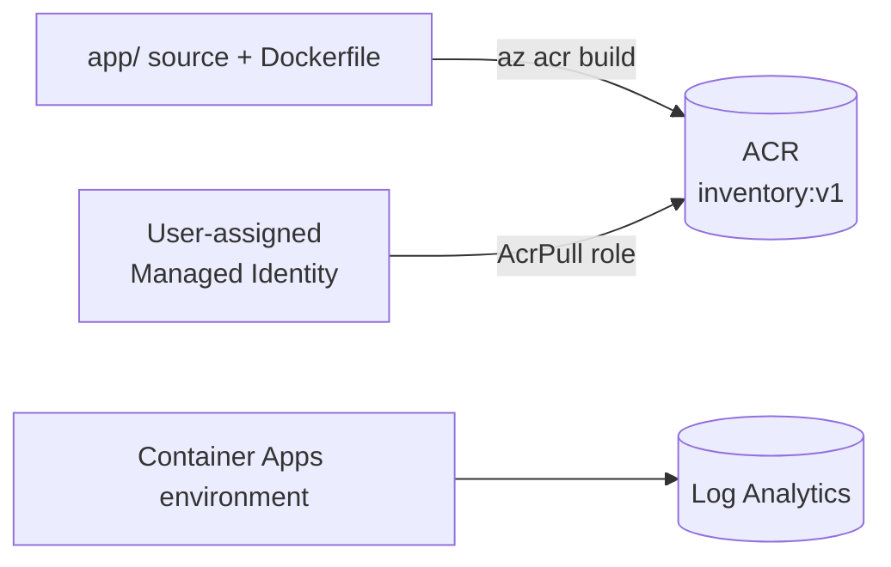

# Lab 3. Create Azure resources & build the image (20 min)

🌐 **English** | [한국어](../lab3-azure-resources.md)

## Goals
- Create a resource group, **Container Registry (ACR)**, **Log Analytics**, a **Container Apps environment** and a **Managed Identity**.
- Build the image in the cloud with **ACR Tasks** — no local Docker required.



> In every new terminal: `source scripts/env.sh`

## 3-1. Resource group

A resource group is a **logical container that lets you delete everything from this lab in one go**.

```bash
az group create --name $RG --location $LOCATION -o table
```

## 3-2. Azure Container Registry (ACR)

A private container image store (think of a private Docker Hub).

```bash
az acr create \
  --resource-group $RG \
  --name $ACR_NAME \
  --sku Basic \
  -o table
```

> `ACR_NAME` must be globally unique. `scripts/env.sh` already appended a unique suffix.

## 3-3. Build the image (ACR Tasks)

Upload the `app/` folder (where the Dockerfile lives), build **in the cloud** and push to ACR.

```bash
az acr build \
  --registry $ACR_NAME \
  --image inventory:v1 \
  ./app
```

Success looks like `Run ID: ... was successful`. Verify:

```bash
az acr repository show-tags --name $ACR_NAME --repository inventory -o table
```

> ⚠️ If a free/trial subscription returns `ACR Tasks are not supported`, use the **local docker build & push** method in [Troubleshooting](troubleshooting.md#acr-tasks).

## 3-4. Log Analytics workspace

This is where container stdout logs end up.

```bash
az monitor log-analytics workspace create \
  --resource-group $RG \
  --workspace-name $LAW_NAME \
  --location $LOCATION \
  -o table

LAW_ID=$(az monitor log-analytics workspace show -g $RG -n $LAW_NAME --query customerId -o tsv)
LAW_KEY=$(az monitor log-analytics workspace get-shared-keys -g $RG -n $LAW_NAME --query primarySharedKey -o tsv)
```

## 3-5. Container Apps environment

An **environment** is the security/network/log boundary shared by Container Apps. (You don't manage a Kubernetes cluster yourself.)

```bash
az containerapp env create \
  --name $ENV_NAME \
  --resource-group $RG \
  --location $LOCATION \
  --logs-workspace-id $LAW_ID \
  --logs-workspace-key $LAW_KEY \
  -o table
```

(Takes 1–3 minutes.)

## 3-6. Grant image-pull permission with a Managed Identity

Instead of an ACR username/password we authenticate with a **Managed Identity**. No password means nothing to leak.

```bash
# 1) Create a user-assigned managed identity
az identity create --name $IDENTITY_NAME --resource-group $RG -o table

IDENTITY_ID=$(az identity show -g $RG -n $IDENTITY_NAME --query id -o tsv)
IDENTITY_PRINCIPAL=$(az identity show -g $RG -n $IDENTITY_NAME --query principalId -o tsv)
ACR_ID=$(az acr show -g $RG -n $ACR_NAME --query id -o tsv)

# 2) Give it the AcrPull (read images) role on the ACR
az role assignment create \
  --assignee-object-id $IDENTITY_PRINCIPAL \
  --assignee-principal-type ServicePrincipal \
  --role AcrPull \
  --scope $ACR_ID -o table
```

> 💡 Why a **user-assigned** identity? You can grant the permission **before** the app exists, which avoids the timing problem where the first deployment can't pull the image. Role assignments can take 1–2 minutes to propagate.

## ✅ Checkpoint

```bash
az resource list -g $RG -o table
```

You should see: **ACR, Log Analytics workspace, Container Apps Environment, Managed Identity**

```bash
az acr repository show-tags --name $ACR_NAME --repository inventory -o tsv   # v1
```

➡️ Next: [Lab 4. Deploy to Container Apps & experience the "state problem"](lab4-deploy.md)
