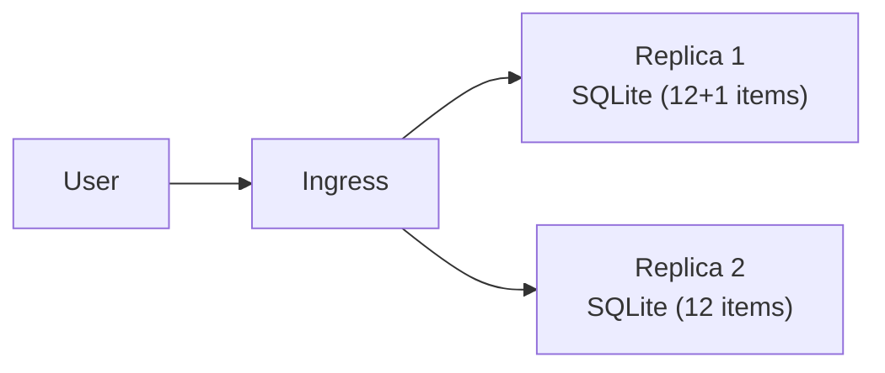

# Lab 4. Deploy to Container Apps & experience the "state problem" (25 min)

🌐 **English** | [한국어](../lab4-deploy.md)

## Goals
- Deploy the image to Container Apps and reach it over an HTTPS URL.
- See for yourself **what happens when an app that uses local SQLite scales out**. (→ the motivation for Lab 5)

> 🕐 **Time-saver**: creating PostgreSQL in Lab 5 takes 5–10 minutes. If you like, run the creation command from [Lab 5-1](lab5-database.md#5-1-create-the-postgresql-flexible-server) **in another terminal first** and continue with this lab.

```bash
source scripts/env.sh
IDENTITY_ID=$(az identity show -g $RG -n $IDENTITY_NAME --query id -o tsv)
```

## 4-1. Create the Container App

```bash
az containerapp create \
  --name $APP_NAME \
  --resource-group $RG \
  --environment $ENV_NAME \
  --image $ACR_NAME.azurecr.io/inventory:v1 \
  --user-assigned $IDENTITY_ID \
  --registry-server $ACR_NAME.azurecr.io \
  --registry-identity $IDENTITY_ID \
  --ingress external \
  --target-port 8000 \
  --cpu 0.5 --memory 1.0Gi \
  --min-replicas 1 --max-replicas 1 \
  -o table
```

| Option | Meaning |
|---|---|
| `--user-assigned` / `--registry-identity` | Authenticate to ACR with the Managed Identity from Lab 3 |
| `--ingress external` | Reachable from the internet over HTTPS (certificate / load balancer handled for you) |
| `--target-port 8000` | Port the container listens on (the gunicorn port in the Dockerfile) |
| `--min/max-replicas 1` | Fixed at one instance for now |

> ⚠️ If you get an image-pull error (`UNAUTHORIZED`), the role assignment hasn't propagated yet. Wait 1–2 minutes and run the same command again.

## 4-2. Open the app

```bash
APP_URL=https://$(az containerapp show -n $APP_NAME -g $RG --query properties.configuration.ingress.fqdn -o tsv)
echo $APP_URL
curl -s $APP_URL/health
```

Open `APP_URL` in the browser. You should see the 12 sample items and, at the bottom, `hostname` (= the container name) and `db backend: sqlite`.

🎉 The on-prem VM app is now served over HTTPS **without managing any server**.

## 4-3. Peek at the logs

```bash
az containerapp logs show -n $APP_NAME -g $RG --tail 20
```

You'll see what the app wrote to stdout (`Seeded 12 sample items`, gunicorn access logs). No SSH into a VM needed.

## 4-4. 🔍 Experiments — what if state lives inside the container?

### Experiment 1: scale to 2 instances

```bash
az containerapp update -n $APP_NAME -g $RG --min-replicas 2 --max-replicas 2 -o none
az containerapp replica list -n $APP_NAME -g $RG --query "[].name" -o tsv
```

Wait until two replicas are listed, then:

1. **Add one item** in the browser (e.g. `Experiment item`).
2. **Refresh the page several times.**

**Observe**: `hostname` at the bottom changes, and the item you just added **appears and disappears**. Each replica has **its own SQLite file**.

```bash
# Also from the terminal: the item count flips between 12 and 13
for i in $(seq 1 10); do curl -s $APP_URL/api/items | python3 -c "import sys,json; print(len(json.load(sys.stdin)), 'items')"; done
```

### Experiment 2: restart the container

```bash
az containerapp revision restart -n $APP_NAME -g $RG \
  --revision $(az containerapp show -n $APP_NAME -g $RG --query properties.latestRevisionName -o tsv)
```

After the restart, refresh: **everything you added is gone** and you're back to the 12 samples. A container's file system is **ephemeral**.

## 4-5. Summary: why is this a problem?



- Containers are things that get **created and destroyed at any time** (autoscale, restart, new releases).
- State (data) must live **outside** the container → a **managed database**.

We fix that in the next lab. For now, set replicas back to 1.

```bash
az containerapp update -n $APP_NAME -g $RG --min-replicas 1 --max-replicas 1 -o none
```

## ✅ Checkpoint
- [ ] You can open the app at `APP_URL`.
- [ ] You saw inconsistent data with 2 replicas.
- [ ] You saw data disappear after a restart.

➡️ Next: [Lab 5. Modernize data with PostgreSQL](lab5-database.md)
