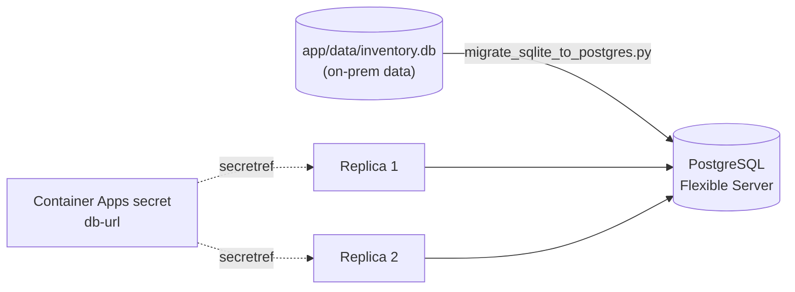

# Lab 5. Modernize data with PostgreSQL (30 min)

🌐 **English** | [한국어](../lab5-database.md)

## Goals
- Create **Azure Database for PostgreSQL Flexible Server**.
- **Migrate** the on-prem SQLite data (`inventory.db` from Lab 1) to PostgreSQL.
- Inject the connection info as a **secret**, and confirm data stays consistent when replicas scale out.



```bash
source scripts/env.sh
```

## 5-1. Create the PostgreSQL Flexible Server

```bash
az postgres flexible-server create \
  --resource-group $RG \
  --name $PG_SERVER \
  --location $LOCATION \
  --admin-user $PG_ADMIN \
  --admin-password "$PG_PASSWORD" \
  --tier Burstable \
  --sku-name Standard_B1ms \
  --storage-size 32 \
  --version 16 \
  --public-access 0.0.0.0 \
  --yes
```

⏳ This takes **5–10 minutes**. Read on while you wait.

| Option | Description |
|---|---|
| `Burstable / Standard_B1ms` | Cheapest SKU for labs (production: GeneralPurpose or higher + high availability) |
| `--public-access 0.0.0.0` | Special rule that allows connections from **Azure-internal services** (Container Apps) |
| Backups | Automatic 7-day backups by default (something you used to build yourself on-prem) |

> ⚠️ **This is a simplification for the lab.** In production use VNet integration + Private Endpoint and Microsoft Entra authentication (Managed Identity) instead of passwords. → [Next steps](lab8-cleanup.md#next-steps)

> ❗ If you get a capacity error like `... is not available in this region`, set `export LOCATION=<another region>` (e.g. `japaneast`) and create **only the DB** there (just change `--location`; keep the resource group and ACR as they are).

## 5-2. Create the database

```bash
az postgres flexible-server db create \
  --resource-group $RG \
  --server-name $PG_SERVER \
  --database-name $PG_DB
```

## 5-3. Allow access from your machine (for the migration)

The migration script runs **right now from your terminal** (Codespaces/PC), so add your public IP to the firewall.

```bash
MY_IP=$(curl -s https://api.ipify.org)
echo $MY_IP

az postgres flexible-server firewall-rule create \
  --resource-group $RG \
  --server-name $PG_SERVER \
  --name allow-my-ip \
  --start-ip-address $MY_IP \
  --end-ip-address $MY_IP
```

## 5-4. Migrate the data (SQLite → PostgreSQL)

Build the connection string.

```bash
PG_HOST=$(az postgres flexible-server show -g $RG -n $PG_SERVER --query fullyQualifiedDomainName -o tsv)
DATABASE_URL="postgresql+psycopg2://$PG_ADMIN:$PG_PASSWORD@$PG_HOST:5432/$PG_DB?sslmode=require"
echo $PG_HOST
```

Run the migration script (from the repo root).

```bash
source app/.venv/bin/activate
pip install -q -r app/requirements.txt

python tools/migrate_sqlite_to_postgres.py \
  --source sqlite:///app/data/inventory.db \
  --target "$DATABASE_URL"
```

Expected output (12 samples + however many items you added in Lab 1):

```
  items: 13 rows copied
Done! Target tables / 완료! 대상 DB 테이블: items
```

> What the script does: ① reads the source (SQLite) schema and creates the same table in PostgreSQL ② copies every row ③ moves the `id` auto-increment sequence to the max value (without this, the first INSERT after migration fails with `duplicate key`).
>
> ⚠️ **If the app connects to the DB first**, it seeds sample data into the empty DB and the script aborts with "already has data". Re-run with `--truncate`. In a real migration, keep the order **migrate → switch the app**.

If `app/data/inventory.db` doesn't exist (you skipped Lab 1), run `python app/app.py` once to create the sample DB, stop it with `Ctrl+C`, and try again.

## 5-5. Inject the connection info as a secret

A connection string containing the DB password goes into a **secret**, not a plain environment variable; the env var then references it with **`secretref:`**.

```bash
az containerapp secret set \
  --name $APP_NAME \
  --resource-group $RG \
  --secrets db-url="$DATABASE_URL"

az containerapp update \
  --name $APP_NAME \
  --resource-group $RG \
  --set-env-vars DATABASE_URL=secretref:db-url APP_VERSION=2.0-pg \
  -o none
```

| Method | Where the value is visible |
|---|---|
| Plain env var (`APP_VERSION=2.0-pg`) | Readable in plain text in the portal/CLI |
| `secretref:db-url` | Masked in the portal/CLI; delivered to the container as an env var |

> 💡 Changing env vars creates a **new revision**; once the new container starts healthy, traffic switches automatically. (More in Lab 6.)

## 5-6. Verify

```bash
APP_URL=https://$(az containerapp show -n $APP_NAME -g $RG --query properties.configuration.ingress.fqdn -o tsv)
curl -s $APP_URL/health
```

You should see `"db_backend":"postgresql"` and `"version":"2.0-pg"`. Check in the browser too.

1. Confirm **all the items you entered locally in Lab 1 are there** (12 samples + your additions) → 🎉 migration succeeded
2. Add a new item

### Lab 4's experiments, once more

```bash
# Scale to 2 replicas
az containerapp update -n $APP_NAME -g $RG --min-replicas 2 --max-replicas 2 -o none

# Is the item count the same no matter which replica answers?
for i in $(seq 1 10); do curl -s $APP_URL/api/items | python3 -c "import sys,json; print(len(json.load(sys.stdin)), 'items')"; done

# Does data survive a restart?
az containerapp revision restart -n $APP_NAME -g $RG \
  --revision $(az containerapp show -n $APP_NAME -g $RG --query properties.latestRevisionName -o tsv)
```

- Every response shows the same count → **state lives outside the app (in the DB), so it's consistent**
- Data survives the restart → **containers are now disposable (stateless)**

Set it back to 1 replica.

```bash
az containerapp update -n $APP_NAME -g $RG --min-replicas 1 --max-replicas 1 -o none
```

## ✅ Checkpoint
- [ ] `db backend` on the page is `postgresql`.
- [ ] The data you entered in Lab 1 is visible.
- [ ] Data is consistent with 2 replicas and persists across restarts.
- [ ] You can explain why the password isn't in code, the image or a plain env var.

➡️ Next: [Lab 6. Logs · autoscaling · blue/green deployment](lab6-operate.md)
