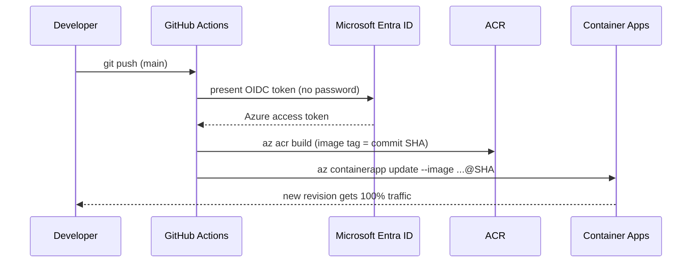

# Lab 7. (Optional) CI/CD with GitHub Actions (20 min)

🌐 **English** | [한국어](../lab7-cicd.md)

## Goals
- On every push to `main`, **build → push to ACR → deploy a new Container Apps revision** automatically.
- Set up **OIDC (workload identity federation)** login so no Azure password or key is stored in GitHub.



> ⚠️ This lab requires permission to **create app registrations** in Microsoft Entra ID. If you don't have it in your work/school tenant, skip to [Lab 8](lab8-cleanup.md).
> First make sure you returned to **single revision mode** in [Lab 6-3 (5)](lab6-operate.md).

```bash
source scripts/env.sh
```

## 7-1. Configure the GitHub ↔ Azure OIDC trust

```bash
SUB_ID=$(az account show --query id -o tsv)
TENANT_ID=$(az account show --query tenantId -o tsv)
GH_REPO=$(gh repo view --json nameWithOwner -q .nameWithOwner)   # e.g. myname/azure-modernization-lab
echo $GH_REPO

# 1) Entra app registration + service principal
APP_ID=$(az ad app create --display-name "gh-aca-lab-$SUFFIX" --query appId -o tsv)
SP_OBJ_ID=$(az ad sp create --id $APP_ID --query id -o tsv)

# 2) Grant Contributor only on this lab's resource group (least scope)
az role assignment create \
  --assignee-object-id $SP_OBJ_ID \
  --assignee-principal-type ServicePrincipal \
  --role Contributor \
  --scope $(az group show -n $RG --query id -o tsv) -o table

# 3) A federated credential that trusts only "workflows run from the main branch of my repo"
#    Recently created repos use immutable subjects (repo:<owner>@<ID>/<repo>@<ID>), so look up
#    the prefix GitHub actually issues. (Falls back to repo:<owner>/<repo> if the lookup fails.)
SUB_PREFIX=$(gh api repos/$GH_REPO/actions/oidc/customization/sub --jq '.sub_claim_prefix // empty' 2>/dev/null)
SUB_PREFIX=${SUB_PREFIX:-repo:$GH_REPO}
echo $SUB_PREFIX

cat > credential.json <<EOF
{
  "name": "github-main",
  "issuer": "https://token.actions.githubusercontent.com",
  "subject": "${SUB_PREFIX}:ref:refs/heads/main",
  "audiences": ["api://AzureADTokenExchange"]
}
EOF
az ad app federated-credential create --id $APP_ID --parameters credential.json
rm credential.json
```

## 7-2. Register secrets / variables in GitHub

Identifiers (client ID etc.) aren't passwords, but by convention they go in secrets.

```bash
gh secret set AZURE_CLIENT_ID       --body "$APP_ID"
gh secret set AZURE_TENANT_ID       --body "$TENANT_ID"
gh secret set AZURE_SUBSCRIPTION_ID --body "$SUB_ID"

gh variable set ACR_NAME       --body "$ACR_NAME"
gh variable set APP_NAME       --body "$APP_NAME"
gh variable set RESOURCE_GROUP --body "$RG"
```

> The default Codespaces token may lack permission, making `gh secret set` fail with `403`. Then register them in the web UI:
> Repo → **Settings → Secrets and variables → Actions**, using the names/values above.
> To see the values: `echo $APP_ID $TENANT_ID $SUB_ID $ACR_NAME $APP_NAME $RG`

## 7-3. Add the workflow

```bash
mkdir -p .github/workflows
cp solution/workflows/deploy.yml .github/workflows/deploy.yml
```

Open the file and read each step (login → `az acr build` → `az containerapp update`).

- The image tag is the **commit SHA** → you can trace which code is deployed, and rollbacks are unambiguous.
- `paths: ["app/**"]` → deploys only when app code changes.

## 7-4. Change code → push → automatic deployment

Let's change the page title so we can see the result. In `app/templates/index.html`:

```diff
-    <h1>📦 Contoso Inventory</h1>
+    <h1>📦 Contoso Inventory — deployed by GitHub Actions 🚀</h1>
```

Commit and push:

```bash
git add -A
git commit -m "Add CI/CD workflow and update title"
git push origin main
```

> If your Lab 2 changes in `app/` are not committed yet, they go out with this push.

Check the run:

```bash
gh run list --limit 3
gh run watch            # follow the latest run live (select it with Enter)
```

Or use the repo's **Actions** tab. It usually takes 2–3 minutes.

## 7-5. Verify

```bash
az containerapp revision list -n $APP_NAME -g $RG \
  --query "[].{name:name, image:properties.template.containers[0].image, traffic:properties.trafficWeight}" -o table
```

A new revision whose image tag is the **commit SHA** should hold 100% of traffic. Refresh the browser to see the new title.

## ✅ Checkpoint
- [ ] The Actions workflow succeeded (green check).
- [ ] The new revision's image tag is the commit SHA.
- [ ] The page title changed.
- [ ] You can explain why no Azure password/key is in the repo. (OIDC)

➡️ Next: [Lab 8. Clean up](lab8-cleanup.md)
