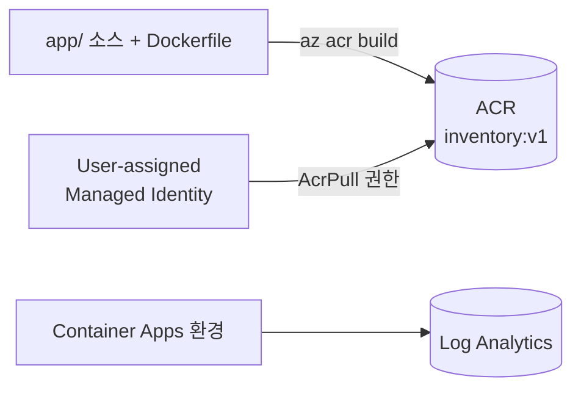

# Lab 3. Azure 리소스 만들기 & 이미지 빌드 (20분)

## 목표
- 리소스 그룹, **Container Registry(ACR)**, **Log Analytics**, **Container Apps 환경**, **Managed Identity** 를 만든다.
- 내 PC/Codespaces 에 Docker 가 없어도 **ACR Tasks** 로 이미지를 클라우드에서 빌드한다.



> 매 터미널 시작 시: `source scripts/env.sh`

## 3-1. 리소스 그룹

리소스 그룹은 한 실습에서 만든 리소스를 **한 번에 지울 수 있게 묶는 논리적 컨테이너**입니다.

```bash
az group create --name $RG --location $LOCATION -o table
```

## 3-2. Azure Container Registry (ACR)

프라이빗 컨테이너 이미지 저장소입니다. (Docker Hub 의 사설 버전)

```bash
az acr create \
  --resource-group $RG \
  --name $ACR_NAME \
  --sku Basic \
  -o table
```

> `ACR_NAME` 은 전 세계에서 유일해야 합니다. `scripts/env.sh` 가 고유 접미사를 붙여 두었습니다.

## 3-3. 이미지 빌드 (ACR Tasks)

`app/` 폴더(Dockerfile 이 있는 곳)를 Azure 로 업로드해서 **클라우드에서** 빌드하고 ACR 에 푸시합니다.

```bash
az acr build \
  --registry $ACR_NAME \
  --image inventory:v1 \
  ./app
```

마지막에 `Run ID: ... was successful` 이 보이면 성공입니다. 확인:

```bash
az acr repository show-tags --name $ACR_NAME --repository inventory -o table
```

> ⚠️ 무료/체험 구독에서 `ACR Tasks are not supported` 오류가 나면 [트러블슈팅](troubleshooting.md#acr-tasks) 의 **로컬 docker build & push** 방법을 사용하세요.

## 3-4. Log Analytics 워크스페이스

컨테이너의 stdout 로그가 모이는 곳입니다.

```bash
az monitor log-analytics workspace create \
  --resource-group $RG \
  --workspace-name $LAW_NAME \
  --location $LOCATION \
  -o table

LAW_ID=$(az monitor log-analytics workspace show -g $RG -n $LAW_NAME --query customerId -o tsv)
LAW_KEY=$(az monitor log-analytics workspace get-shared-keys -g $RG -n $LAW_NAME --query primarySharedKey -o tsv)
```

## 3-5. Container Apps 환경

**환경(Environment)** 은 여러 Container App 이 함께 쓰는 보안/네트워크/로그 경계입니다. (Kubernetes 클러스터를 직접 관리하지 않아도 됩니다.)

```bash
az containerapp env create \
  --name $ENV_NAME \
  --resource-group $RG \
  --location $LOCATION \
  --logs-workspace-id $LAW_ID \
  --logs-workspace-key $LAW_KEY \
  -o table
```

(1~3분 소요)

## 3-6. Managed Identity 로 ACR 이미지 Pull 권한 부여

ACR 사용자 이름/비밀번호를 쓰는 대신 **Managed Identity** 로 인증합니다. 비밀번호가 없으니 유출될 일도 없습니다.

```bash
# 1) 사용자 할당 관리 ID 생성
az identity create --name $IDENTITY_NAME --resource-group $RG -o table

IDENTITY_ID=$(az identity show -g $RG -n $IDENTITY_NAME --query id -o tsv)
IDENTITY_PRINCIPAL=$(az identity show -g $RG -n $IDENTITY_NAME --query principalId -o tsv)
ACR_ID=$(az acr show -g $RG -n $ACR_NAME --query id -o tsv)

# 2) 이 ID 에게 ACR 의 AcrPull(이미지 읽기) 역할 부여
az role assignment create \
  --assignee-object-id $IDENTITY_PRINCIPAL \
  --assignee-principal-type ServicePrincipal \
  --role AcrPull \
  --scope $ACR_ID -o table
```

> 💡 왜 **사용자 할당** ID 일까? 앱을 만들기 **전에** 권한을 먼저 부여해 둘 수 있어서, 첫 배포에서 이미지 Pull 이 실패하는 타이밍 이슈가 없습니다. 역할 할당이 전파되는 데 최대 1~2분 걸릴 수 있습니다.

## ✅ 체크포인트

```bash
az resource list -g $RG -o table
```

아래 리소스가 보여야 합니다: **ACR, Log Analytics workspace, Container Apps Environment, Managed Identity**

```bash
az acr repository show-tags --name $ACR_NAME --repository inventory -o tsv   # v1
```

➡️ 다음: [Lab 4. Container Apps 배포 & "상태 문제" 체험](lab4-deploy.md)
