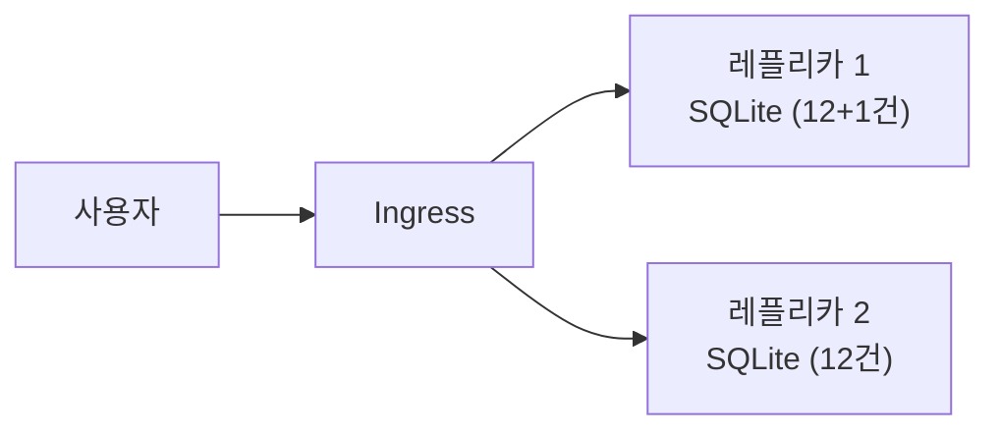

# Lab 4. Container Apps 배포 & "상태 문제" 체험 (25분)

🌐 [English](en/lab4-deploy.md) | **한국어**

## 목표
- 이미지를 Container Apps 로 배포하고 HTTPS URL 로 접속한다.
- **로컬 SQLite 를 쓰는 앱이 스케일 아웃되면 어떤 일이 생기는지** 직접 확인한다. (→ Lab 5 의 동기)

> 🕐 **시간 절약 팁**: Lab 5 의 PostgreSQL 생성은 5~10분 걸립니다. 원하면 [Lab 5-1](lab5-database.md#5-1-postgresql-flexible-server-생성) 의 생성 명령을 **다른 터미널에서 먼저 실행**해 두고 이 Lab 을 진행하세요.

```bash
source scripts/env.sh
IDENTITY_ID=$(az identity show -g $RG -n $IDENTITY_NAME --query id -o tsv)
```

## 4-1. Container App 생성

```bash
az containerapp create \
  --name $APP_NAME \
  --resource-group $RG \
  --environment $ENV_NAME \
  --image $ACR_NAME.azurecr.io/inventory:v1 \
  --user-assigned $IDENTITY_ID \
  --registry-server $ACR_NAME.azurecr.io \
  --registry-identity $IDENTITY_ID \
  --ingress external \
  --target-port 8000 \
  --cpu 0.5 --memory 1.0Gi \
  --min-replicas 1 --max-replicas 1 \
  -o table
```

| 옵션 | 의미 |
|---|---|
| `--user-assigned` / `--registry-identity` | Lab 3 의 Managed Identity 로 ACR 인증 |
| `--ingress external` | 인터넷에서 HTTPS 로 접근 가능 (인증서/로드밸런서 자동) |
| `--target-port 8000` | 컨테이너가 listen 하는 포트 (Dockerfile 의 gunicorn 포트) |
| `--min/max-replicas 1` | 지금은 인스턴스 1개 고정 |

> ⚠️ 이미지 Pull 권한 오류(`UNAUTHORIZED`)가 나면 역할 할당 전파 지연입니다. 1~2분 기다렸다가 같은 명령을 다시 실행하세요.

## 4-2. 접속

```bash
APP_URL=https://$(az containerapp show -n $APP_NAME -g $RG --query properties.configuration.ingress.fqdn -o tsv)
echo $APP_URL
curl -s $APP_URL/health
```

브라우저에서 `APP_URL` 을 열어 앱이 동작하는지 확인합니다. 샘플 재고 12건과 하단의 `hostname`(= 컨테이너 이름), `db backend: sqlite` 를 확인하세요.

🎉 온프렘 VM 앱이 **서버 관리 없이** HTTPS 로 서비스되고 있습니다.

## 4-3. 로그 보기 (맛보기)

```bash
az containerapp logs show -n $APP_NAME -g $RG --tail 20
```

앱이 stdout 으로 쓴 로그(`Seeded 12 sample items`, gunicorn 접속 로그)가 보입니다. VM 에 SSH 접속할 필요가 없습니다.

## 4-4. 🔍 실험 — 상태가 컨테이너 안에 있으면?

### 실험 1: 인스턴스를 2개로 늘리기

```bash
az containerapp update -n $APP_NAME -g $RG --min-replicas 2 --max-replicas 2 -o none
az containerapp replica list -n $APP_NAME -g $RG --query "[].name" -o tsv
```

레플리카 2개가 보일 때까지 잠시 기다린 뒤:

1. 브라우저에서 **재고 1건을 추가**합니다. (예: `실험용 항목`)
2. 페이지를 **여러 번 새로고침**합니다.

**관찰**: 하단 `hostname` 이 바뀌고, 어떤 때는 방금 추가한 항목이 **보였다가 안 보였다가** 합니다. 레플리카마다 **자기만의 SQLite 파일**을 갖고 있기 때문입니다.

```bash
# 터미널에서도 확인: 요청할 때마다 항목 수가 12 와 13 으로 섞여 나옵니다
for i in $(seq 1 10); do curl -s $APP_URL/api/items | python3 -c "import sys,json; print(len(json.load(sys.stdin)), 'items')"; done
```

항목 수가 12 와 13 으로 섞여 나옵니다.

> 💡 두 번째 레플리카가 아직 준비 중이면 한쪽 값만 나올 수 있습니다. 30초 정도 기다렸다가 다시 실행하세요.

### 실험 2: 컨테이너 재시작

```bash
az containerapp revision restart -n $APP_NAME -g $RG \
  --revision $(az containerapp show -n $APP_NAME -g $RG --query properties.latestRevisionName -o tsv)
```

재시작 후 새로고침하면 **추가했던 항목이 모두 사라지고** 샘플 12건으로 돌아갑니다. 컨테이너 파일 시스템은 **임시(ephemeral)** 이기 때문입니다.

## 4-5. 정리: 왜 문제인가?



- 컨테이너는 **언제든 만들어지고 사라지는** 존재입니다 (오토스케일, 재시작, 새 버전 배포).
- 상태(데이터)는 컨테이너 **밖**의 서비스에 있어야 합니다 → **관리형 DB**.

다음 Lab 에서 해결합니다. 일단 레플리카를 1개로 되돌립니다.

```bash
az containerapp update -n $APP_NAME -g $RG --min-replicas 1 --max-replicas 1 -o none
```

## ✅ 체크포인트
- [ ] `APP_URL` 로 접속해 앱이 보인다.
- [ ] 레플리카가 2개일 때 데이터가 일관되지 않는 현상을 확인했다.
- [ ] 재시작하면 데이터가 사라지는 것을 확인했다.

➡️ 다음: [Lab 5. PostgreSQL로 데이터 현대화](lab5-database.md)
