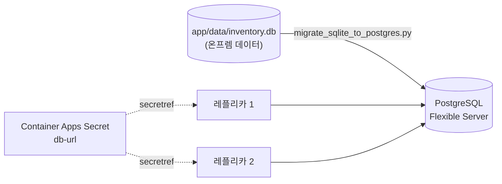

# Lab 5. PostgreSQL로 데이터 현대화 (30분)

🌐 [English](en/lab5-database.md) | **한국어**

## 목표
- **Azure Database for PostgreSQL Flexible Server** 를 만든다.
- 온프렘 SQLite 데이터(Lab 1 의 `inventory.db`)를 PostgreSQL 로 **이전**한다.
- 접속 정보를 **Secret** 으로 안전하게 주입하고, 레플리카가 늘어나도 데이터가 일관됨을 확인한다.



```bash
source scripts/env.sh
```

## 5-1. PostgreSQL Flexible Server 생성

```bash
az postgres flexible-server create \
  --resource-group $RG \
  --name $PG_SERVER \
  --location $LOCATION \
  --admin-user $PG_ADMIN \
  --admin-password "$PG_PASSWORD" \
  --tier Burstable \
  --sku-name Standard_B1ms \
  --storage-size 32 \
  --version 16 \
  --public-access 0.0.0.0 \
  --yes
```

⏳ **5~10분** 걸립니다. 기다리는 동안 아래를 읽어 보세요.

| 옵션 | 설명 |
|---|---|
| `Burstable / Standard_B1ms` | 실습용 가장 저렴한 SKU (운영은 GeneralPurpose 이상 + 고가용성) |
| `--public-access 0.0.0.0` | **Azure 내부 서비스(Container Apps)** 의 접속을 허용하는 특수 규칙 |
| 백업 | 기본 7일 자동 백업 (온프렘에서는 직접 만들던 것) |

> ⚠️ **실습 단순화를 위한 선택입니다.** 운영 환경에서는 VNet 통합 + Private Endpoint, 그리고 비밀번호 대신 Microsoft Entra 인증(Managed Identity) 사용을 권장합니다. → [다음 단계](lab8-cleanup.md#다음-단계)

> ❗ `... is not available in this region` 같은 용량 오류가 나면 `export LOCATION=<다른 리전>` (예: `japaneast`) 으로 바꾼 뒤 **리소스 그룹과 ACR 은 그대로 두고** DB 만 해당 리전에 생성해도 됩니다. (`--location` 만 바꿔 실행)

## 5-2. 데이터베이스 생성

```bash
az postgres flexible-server db create \
  --resource-group $RG \
  --server-name $PG_SERVER \
  --database-name $PG_DB
```

## 5-3. 내 환경에서 접속 허용 (마이그레이션용)

마이그레이션 스크립트를 **지금 내 터미널**(Codespaces/PC)에서 실행하므로, 내 공인 IP 를 방화벽에 추가합니다.

```bash
MY_IP=$(curl -s https://api.ipify.org)
echo $MY_IP

az postgres flexible-server firewall-rule create \
  --resource-group $RG \
  --server-name $PG_SERVER \
  --name allow-my-ip \
  --start-ip-address $MY_IP \
  --end-ip-address $MY_IP
```

## 5-4. 데이터 이전 (SQLite → PostgreSQL)

접속 문자열(Connection String)을 만듭니다.

```bash
PG_HOST=$(az postgres flexible-server show -g $RG -n $PG_SERVER --query fullyQualifiedDomainName -o tsv)
DATABASE_URL="postgresql+psycopg2://$PG_ADMIN:$PG_PASSWORD@$PG_HOST:5432/$PG_DB?sslmode=require"
echo $PG_HOST
```

마이그레이션 스크립트를 실행합니다. (저장소 루트에서)

```bash
source app/.venv/bin/activate
pip install -q -r app/requirements.txt

python tools/migrate_sqlite_to_postgres.py \
  --source sqlite:///app/data/inventory.db \
  --target "$DATABASE_URL"
```

예상 출력 (샘플 12건 + Lab 1 에서 직접 추가한 개수):

```
  items: 13 rows copied
Done! Target tables / 완료! 대상 DB 테이블: items
```

> 스크립트가 하는 일: ① 원본(SQLite) 스키마를 읽어서 PostgreSQL 에 같은 테이블 생성 ② 모든 행 복사 ③ `id` 자동 증가 시퀀스를 최대값으로 맞춤 (이걸 안 하면 이전 후 첫 INSERT 가 `duplicate key` 로 실패합니다)
>
> ⚠️ **앱이 DB 에 먼저 접속하면** 앱이 빈 DB 에 샘플 데이터를 넣어 버려서 스크립트가 "이미 데이터가 있습니다" 로 중단됩니다. 이때는 `--truncate` 옵션을 붙여 다시 실행하세요. 실제 이전 작업에서는 **이전 → 앱 전환** 순서를 지키는 것이 중요합니다.

`app/data/inventory.db` 가 없다면(Lab 1 건너뜀) `python app/app.py` 를 한 번 실행해 샘플 DB 를 만든 뒤 `Ctrl+C` 로 종료하고 다시 시도하세요.

## 5-5. 접속 정보를 Secret 으로 주입

DB 비밀번호가 포함된 접속 문자열은 일반 환경 변수가 아니라 **Secret** 으로 저장하고, 환경 변수에서는 **`secretref:`** 로 참조합니다.

```bash
az containerapp secret set \
  --name $APP_NAME \
  --resource-group $RG \
  --secrets db-url="$DATABASE_URL"

az containerapp update \
  --name $APP_NAME \
  --resource-group $RG \
  --set-env-vars DATABASE_URL=secretref:db-url APP_VERSION=2.0-pg \
  -o none
```

| 방식 | 값이 보이는 곳 |
|---|---|
| 일반 환경 변수 (`APP_VERSION=2.0-pg`) | 포털/CLI 에서 평문 조회 가능 |
| `secretref:db-url` | 포털/CLI 에서 값이 가려짐, 컨테이너에는 환경 변수로 전달 |

> 💡 환경 변수를 바꾸면 **새 리비전**이 만들어지고, 새 컨테이너가 정상 기동하면 트래픽이 자동 전환됩니다. (Lab 6 에서 더 자세히)

## 5-6. 검증

```bash
APP_URL=https://$(az containerapp show -n $APP_NAME -g $RG --query properties.configuration.ingress.fqdn -o tsv)
curl -s $APP_URL/health
```

`"db_backend":"postgresql"`, `"version":"2.0-pg"` 가 보여야 합니다. 브라우저에서도 확인하세요.

1. 화면의 재고가 **Lab 1 에서 로컬로 입력했던 항목까지 모두**(샘플 12건 + 추가분) 보이는지 확인 → 🎉 데이터 이전 성공
2. 새 항목을 하나 추가

### 다시 한 번, Lab 4 의 실험

```bash
# 레플리카 2개로 확장
az containerapp update -n $APP_NAME -g $RG --min-replicas 2 --max-replicas 2 -o none

# 항목 수가 어느 레플리카에서든 동일한지 확인
for i in $(seq 1 10); do curl -s $APP_URL/api/items | python3 -c "import sys,json; print(len(json.load(sys.stdin)), 'items')"; done

# 재시작해도 데이터가 남는지 확인
az containerapp revision restart -n $APP_NAME -g $RG \
  --revision $(az containerapp show -n $APP_NAME -g $RG --query properties.latestRevisionName -o tsv)
```

- 모든 응답이 같은 항목 수 → **상태가 앱 밖(DB)에 있으므로 일관됨**
- 재시작 후에도 데이터 유지 → **컨테이너는 이제 마음껏 버려도 되는(stateless) 존재**

다시 1개로 되돌립니다.

```bash
az containerapp update -n $APP_NAME -g $RG --min-replicas 1 --max-replicas 1 -o none
```

## ✅ 체크포인트
- [ ] 앱 화면의 `db backend` 가 `postgresql` 이다.
- [ ] Lab 1 에서 입력한 데이터가 보인다.
- [ ] 레플리카가 2개여도 데이터가 일관되고, 재시작해도 유지된다.
- [ ] 비밀번호가 코드/이미지/일반 환경 변수에 없다는 것을 설명할 수 있다.

➡️ 다음: [Lab 6. 로그 · 오토스케일 · 블루/그린 배포](lab6-operate.md)
