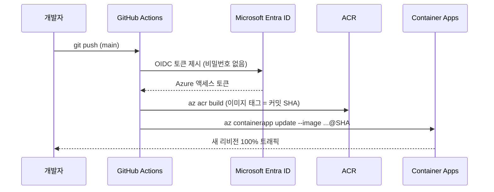

# Lab 7. (선택) GitHub Actions 로 CI/CD 만들기 (20분)

🌐 [English](en/lab7-cicd.md) | **한국어**

## 목표
- `main` 브랜치에 푸시하면 **자동으로 빌드 → ACR 푸시 → Container Apps 새 리비전 배포** 되게 한다.
- Azure 비밀번호/키를 GitHub 에 저장하지 않는 **OIDC(Workload Identity Federation)** 로그인을 구성한다.



> ⚠️ 이 Lab 은 Microsoft Entra ID 에서 **앱 등록**을 만들 수 있는 권한이 필요합니다. 회사/학교 테넌트에서 권한이 없다면 건너뛰고 [Lab 8](lab8-cleanup.md) 로 가도 됩니다.
> 먼저 [Lab 6-3(5)](lab6-operate.md) 에서 **단일 리비전 모드**로 돌아왔는지 확인하세요.

```bash
source scripts/env.sh
```

## 7-1. GitHub ↔ Azure OIDC 신뢰 구성

```bash
SUB_ID=$(az account show --query id -o tsv)
TENANT_ID=$(az account show --query tenantId -o tsv)
GH_REPO=$(gh repo view --json nameWithOwner -q .nameWithOwner)   # 예: myname/azure-modernization-lab
echo $GH_REPO

# 1) Entra 앱 등록 + 서비스 주체
APP_ID=$(az ad app create --display-name "gh-aca-lab-$SUFFIX" --query appId -o tsv)
SP_OBJ_ID=$(az ad sp create --id $APP_ID --query id -o tsv)

# 2) 이 실습의 리소스 그룹에만 Contributor 권한 부여 (최소 범위)
az role assignment create \
  --assignee-object-id $SP_OBJ_ID \
  --assignee-principal-type ServicePrincipal \
  --role Contributor \
  --scope $(az group show -n $RG --query id -o tsv) -o table

# 3) "내 저장소의 main 브랜치에서 실행된 워크플로" 만 신뢰하는 Federated Credential
cat > credential.json <<EOF
{
  "name": "github-main",
  "issuer": "https://token.actions.githubusercontent.com",
  "subject": "repo:${GH_REPO}:ref:refs/heads/main",
  "audiences": ["api://AzureADTokenExchange"]
}
EOF
az ad app federated-credential create --id $APP_ID --parameters credential.json
rm credential.json
```

## 7-2. GitHub 에 Secret / Variable 등록

식별자 값(Client ID 등)은 비밀번호가 아니지만 관례적으로 Secret 에 둡니다.

```bash
gh secret set AZURE_CLIENT_ID       --body "$APP_ID"
gh secret set AZURE_TENANT_ID       --body "$TENANT_ID"
gh secret set AZURE_SUBSCRIPTION_ID --body "$SUB_ID"

gh variable set ACR_NAME       --body "$ACR_NAME"
gh variable set APP_NAME       --body "$APP_NAME"
gh variable set RESOURCE_GROUP --body "$RG"
```

> Codespaces 의 기본 토큰은 권한이 부족해 `gh secret set` 이 `403` 으로 실패할 수 있습니다. 그 경우 웹에서 직접 등록하세요:
> 저장소 → **Settings → Secrets and variables → Actions** 에서 위 이름/값으로 추가.
> 값 확인: `echo $APP_ID $TENANT_ID $SUB_ID $ACR_NAME $APP_NAME $RG`

## 7-3. 워크플로 추가

```bash
mkdir -p .github/workflows
cp solution/workflows/deploy.yml .github/workflows/deploy.yml
```

파일을 열어 각 단계(로그인 → `az acr build` → `az containerapp update`)를 읽어 보세요.

- 이미지 태그는 **커밋 SHA** 입니다 → 어떤 코드가 배포되었는지 추적 가능, 롤백도 명확.
- `paths: ["app/**"]` → 앱 코드가 바뀔 때만 배포.

## 7-4. 코드 수정 → 푸시 → 자동 배포

화면 제목을 바꿔서 배포 결과를 눈으로 확인해 봅시다. `app/templates/index.html` 에서:

```diff
-    <h1>📦 Contoso Inventory</h1>
+    <h1>📦 Contoso Inventory — deployed by GitHub Actions 🚀</h1>
```

커밋 & 푸시:

```bash
git add -A
git commit -m "Add CI/CD workflow and update title"
git push origin main
```

> Lab 2 에서 수정한 `app/` 변경 사항이 아직 커밋 전이라면 이 푸시에 함께 포함됩니다.

실행 상태 확인:

```bash
gh run list --limit 3
gh run watch            # 가장 최근 실행을 실시간으로 보기 (Enter 로 선택)
```

또는 저장소의 **Actions** 탭에서 확인합니다. 보통 2~3분 걸립니다.

## 7-5. 결과 확인

```bash
az containerapp revision list -n $APP_NAME -g $RG \
  --query "[].{name:name, image:properties.template.containers[0].image, traffic:properties.trafficWeight}" -o table
```

이미지 태그가 **커밋 SHA** 인 새 리비전이 100% 트래픽을 받고 있어야 합니다. 브라우저를 새로고침하면 바뀐 제목이 보입니다.

## ✅ 체크포인트
- [ ] Actions 워크플로가 성공(초록 체크)했다.
- [ ] 새 리비전의 이미지 태그가 커밋 SHA 이다.
- [ ] 화면 제목이 바뀌었다.
- [ ] 저장소에 Azure 비밀번호/키가 없다는 것을 설명할 수 있다. (OIDC)

➡️ 다음: [Lab 8. 리소스 정리](lab8-cleanup.md)
